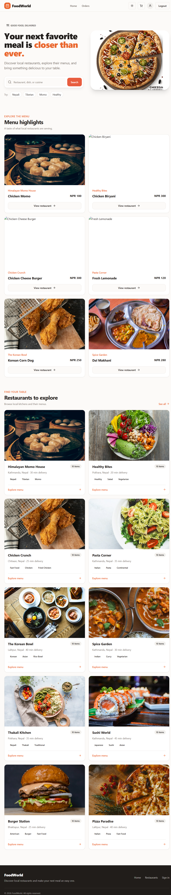
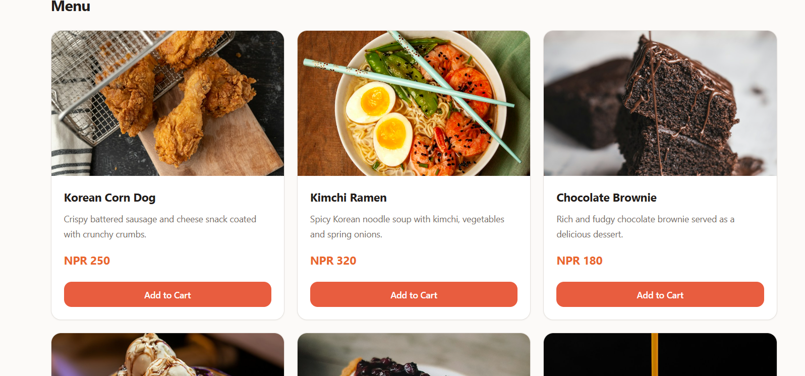
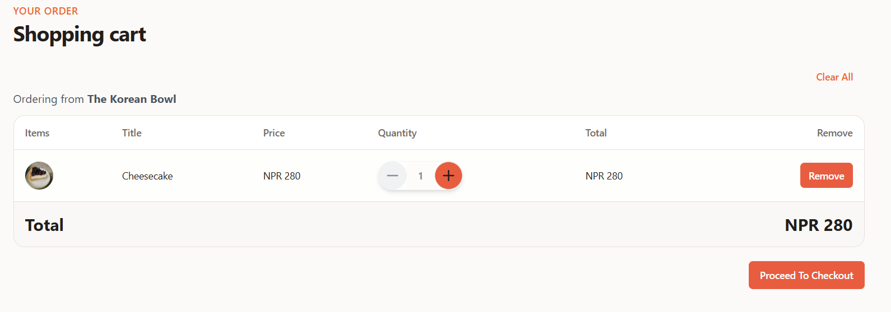
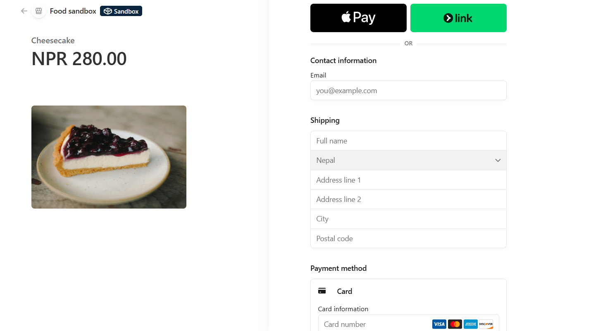
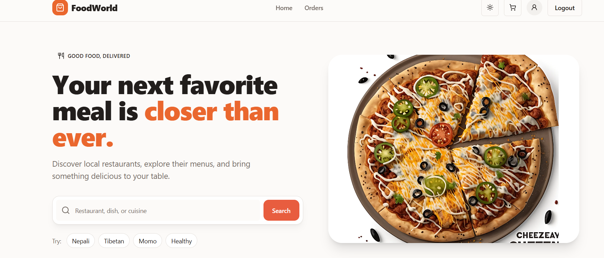

# 🍔 FoodWorld – MERN Food Ordering Application

A full-stack restaurant ordering platform built using the **MERN stack**. FoodWorld allows customers to explore restaurants, browse menus, manage their carts, and place orders through Stripe Checkout. Restaurant owners can manage their restaurant profiles, menu items, and customer orders through a dedicated dashboard.

---

## 📸 Screenshots

<!-- Add your application screenshots inside the screenshots/ directory -->

### Home Page



### Restaurant Menu


### Shopping Cart


### Checkout


### Restaurant Dashboard


---

## ✨ Features

### Customer Features
- Browse available restaurants.
- Explore restaurant menus and food items.
- Add and remove items from the shopping cart.
- Single-restaurant cart management.
- Secure checkout using Stripe.
- User authentication and email verification.
- Password reset functionality.
- View customer profiles and orders.

### Restaurant Owner Features
- Restaurant profile management.
- Create, update, and manage menu items.
- Upload restaurant and food images.
- View incoming customer orders.
- Update order statuses.
- Access a dedicated restaurant dashboard.

### Security and Payments
- JWT-based authentication using HTTP-only cookies.
- Protected routes and account verification.
- Server-side order price calculation.
- Stripe Checkout integration.
- Stripe webhook signature verification.

---

## 🛠️ Tech Stack

### Frontend


### Backend


### Database and Services


**Additional tools:** Axios, React Router, Mailtrap, JWT, Git, and GitHub.

---

## 💻 Languages Used

- TypeScript
- JavaScript
- HTML
- CSS

The application primarily uses TypeScript across its frontend and backend.

---

## ⚙️ Installation and Setup

### Prerequisites

Make sure you have installed:

- [Node.js 20+](https://nodejs.org/)
- npm
- [MongoDB](https://www.mongodb.com/)
- [Cloudinary](https://cloudinary.com/)
- [Mailtrap](https://mailtrap.io/)
- [Stripe](https://stripe.com/)

### 1. Clone the Repository

```bash
git clone YOUR_REPOSITORY_URL
cd FoodWorld
```

### 2. Install Dependencies

```bash
npm install
npm install --prefix client
```

### 3. Configure Environment Variables

Create a `.env` file in the project root using `.env.example` as a reference.

```env
PORT=3000
MONGO_URI=your_mongodb_connection_string
SECRET_KEY=your_jwt_secret
FRONTEND_URL=http://localhost:5173

CLOUD_NAME=your_cloudinary_name
API_KEY=your_cloudinary_api_key
API_SECRET=your_cloudinary_api_secret

MAILTRAP_API_TOKEN=your_mailtrap_token

STRIPE_SECRET_KEY=your_stripe_secret_key
WEBHOOK_ENDPOINT_SECRET=your_stripe_webhook_secret

VITE_API_BASE_URL=http://localhost:3000/api/v1
```

### 4. Start the Backend

From the project root:

```bash
npm run dev
```

### 5. Start the Frontend

Open another terminal:

```bash
npm run dev --prefix client
```

Open the local URL provided by Vite:

```text
http://localhost:5173
```

---

## 💳 Stripe Payment Testing

FoodWorld uses Stripe Checkout for payment processing.

To test payments locally:

1. Configure your Stripe test secret key.
2. Install and authenticate the Stripe CLI.
3. Run the project's Stripe forwarding command:

```bash
npm run stripe
```

4. Copy the webhook signing secret generated by Stripe CLI into `WEBHOOK_ENDPOINT_SECRET`.
5. Use Stripe's test card details to complete a test checkout.

The backend calculates order prices using database menu prices rather than trusting browser-submitted prices.

---

## 📜 Available Scripts

| Command | Description |
|---|---|
| `npm run dev` | Start backend development server |
| `npm run dev --prefix client` | Start frontend development server |
| `npm run build --prefix client` | Type-check and build frontend |
| `npm run lint --prefix client` | Run frontend ESLint |
| `npm run stripe` | Start Stripe webhook forwarding |

---

## 🚧 Current Limitations

- Each owner account manages one restaurant.
- Ratings and reviews are not currently implemented.
- Delivery-fee calculation is not implemented.
- Inventory availability management is not implemented.
- Historical sales charts are not currently available.
- An automated test suite has not yet been added.
- External services must be configured to test payment, email, image upload, and database workflows end to end.

---

## 🔮 Future Improvements

- Restaurant ratings and customer reviews.
- Real-time order tracking.
- Delivery management.
- Advanced restaurant search and filtering.
- Discount coupons and promotional offers.
- Multiple customer delivery addresses.
- Restaurant analytics and sales reports.
- Automated testing and CI/CD integration.

---
